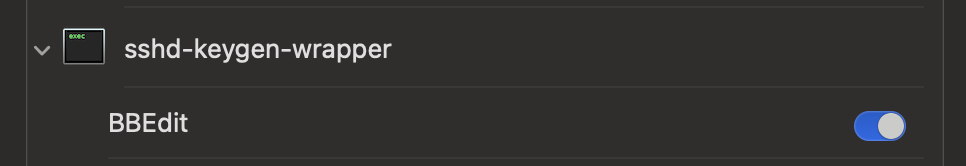

rbbedit
=======

Easily edit server files on your workstation using [BBEdit][].

[BBEdit]: http://www.barebones.com/products/bbedit/

**Important Update: Fix for macOS "Automation Permissions"**

A new feature has been added to `rbbedit` to address the issue of missing Automation permissions when running `bbedit`
from an SSH session. Users can now request Automation permissions by passing the `-P` argument to `rbbedit`. This will
display a dialog in BBEdit, prompting the user to grant the necessary permissions for `sshd-keygen-wrapper` to control
BBEdit. The permissions only need to be requested once, to update System Settings. 

Please see the "Requesting Automation Permissions" section below for detailed instructions on how to use this new
feature.

Table of Contents
----------------
- [Overview](#unleash-the-power-of-bbedit-for-remote-file-editing)
- [Usage](#usage)
- [Requirements](#requirements)
  - [Local machine](#local-machine)
  - [Remote machine](#remote-machine)
- [Installation](#installation)
  - [Server Host](#server-host)
  - [BBEdit workstation](#bbedit-workstation)
- [Script options](#script-options)
  - [User Defaults](#user-defaults)
  - [Set as EDITOR](#set-as-editor)
- [Copy Methods](#copy-methods)
- [New Files](#new-files)
- [Edit Hooks](#edit-hooks)
- [Background Wait](#background-wait)
- [Requesting Automation Permissions](#requesting-automation-permissions)
- [Restricting SSH Access](#restricting-ssh-access-with-bbedit-restricted)
- [SSH Identity Files](#ssh-identity-files)
- [SSH Key Copy](#ssh-key-copy)
- [Self Updating](#self-updating)
- [Known Issues](#known-issues)
- [Releasing](#releasing)
- [Project Home](#project-home)
- [License](#license)

Unleash the Power of BBEdit for Remote File Editing
-----------------------------------------------------------

As a developer or sysadmin, you often find yourself working on remote hosts, connected via SSH. While command-line
editors like vi are available on the server, you miss the rich features and intuitive interface of your favorite text
editor, BBEdit, on your macOS workstation.

That's where `rbbedit` comes in. This powerful tool bridges the gap between your local BBEdit installation and remote
file editing needs. With `rbbedit`, you can seamlessly open and edit files residing on remote hosts using the full
capabilities of BBEdit, right from your macOS workstation.

BBEdit is the leading professional HTML and text editor for macOS, crafted to serve the needs of writers, web authors,
and software developers. It provides an abundance of features for editing, searching, and manipulating prose, source
code, and textual data. By leveraging `rbbedit`, you can bring the power of BBEdit to your remote file editing workflow.

Imagine the convenience of editing Apache configuration files, server-side JavaScript, or web page content with the
familiar and feature-rich interface of BBEdit. No more struggling with command-line editors or transferring files back
and forth. With `rbbedit`, you can efficiently edit remote files as if they were local, thanks to BBEdit's built-in SFTP
support.

Whether you're tweaking configuration files, debugging scripts, or updating web content, `rbbedit` streamlines your
workflow and boosts your productivity. It allows you to leverage the full potential of BBEdit's editing capabilities
while seamlessly integrating with your remote development environment.

It's important to note that `rbbedit` is designed to open individual files rather than directories. While BBEdit
supports opening directories, `rbbedit` focuses on providing a smooth experience for editing specific files.
Additionally, `rbbedit` works with real files on disk and does not support reading from standard input (stdin) in its
current version.

If you frequently find yourself editing files on remote hosts and yearning for the power and convenience of BBEdit,
`rbbedit` is the tool you've been looking for. Embrace the efficiency and familiarity of BBEdit for your remote file
editing needs with `rbbedit`.

Usage
-----

Connect to `server-host` from the BBEdit workstation.

	workstation$ ssh server-host

Open `filename` in BBEdit on workstation, using default copy method (sftp).

	server-host$ rbbedit filename

Open `filename` in BBEdit, connecting to workstation as `myuser`.

	server-host$ rbbedit -u myuser filename

Open `filename` in BBEdit, using scp method.

	server-host$ rbbedit -m scp filename

Open `filename` and skip any configured edit hooks.

	server-host$ rbbedit -E filename

Open `filename` in BBEdit, using ExpanDrive with volume named `expandrive-volume`.

	server-host$ rbbedit -x expandrive-volume filename

Request permission for `sshd-keygen-wrapper` to control BBEdit.

	server-host$ rbbedit -P

Send SSH public key from `server-host` to workstation.

	server-host$ rbbedit -u myuser -k send

Get SSH public key from workstation.

	server-host$ rbbedit -u myuser -k get


Requirements
------------

#### Local machine

* `sshd` must be enabled, and if needed, with firewall and port forwarding configured to allow access to BBEdit workstation
* BBEdit command line utilities
* SSH keys for user account *(to avoid entering password repeatedly)*

#### Remote machine

* `sh`
* `ssh`
* common unix utilities (such as `basename`, `dirname`, `curl`)
* SSH keys for user account *(to avoid entering password repeatedly)*


Installation
------------

#### Server Host

* Automatic installation with: 
  * `curl -fsSL https://github.com/cngarrison/rbbedit/releases/latest/download/install.sh | bash`
* Or install manually from GitHub:
  * `curl -fsSLO https://github.com/cngarrison/rbbedit/releases/latest/download/rbbedit`
  * `chmod 755 rbbedit`
  * Copy `rbbedit` somewhere in `PATH`
  * `cp rbbedit /usr/local/bin/`
* Or clone from GitHub:
  * `git clone https://github.com/cngarrison/rbbedit.git`
  * `cd rbbedit`
  * `./install.sh`
* Create SSH key pair for user account (unless already done)
  * `ssh-keygen`
* Optionally, check a downloaded `rbbedit` was published by this repository's release workflow (needs the GitHub CLI):
  * `gh attestation verify rbbedit --repo cngarrison/rbbedit`
  * or compare against the release's `SHA256SUMS`: `sha256sum --ignore-missing -c SHA256SUMS`

#### BBEdit workstation

* Enable SSH (remote login)
* Configure firewall and port forwarding to allow SSH connections
* Copy SSH public key from server(s) to .ssh/authorized_keys (keys can be copied with the `-k` option)


Script options
--------------

* `-U username`: server-host/SFTP user; specify username to use in hostname argument for SFTP command - will default to $USER
* `-H hostname`: server-host/SFTP host; specify hostname or IP address - will default to $HOSTNAME
* `-u username`: workstation/SSH user; specify username to use in hostname argument for SSH command
* `-h hostname`: workstation/SSH host; specify hostname or IP address, optionally prefix with USER@, eg. myuser@myworkstation.example.com
* `-p port`: workstation/SSH port; connect to SSH using port other than 22
* `-I identity-file`: workstation/SSH identity; private key used for all connections to the workstation (adds `-o IdentitiesOnly=yes`)
* `-m copy-method`: `sftp | ftp | expan | scp | rsync`  - method used to copy files between hosts
* `-x expandrive-volume`: volume name as configured in drives list of ExpanDrive, implies `-m expan`
* `-k copy-direction`: `get | send`  - direction to copy the SSH key
* `-i identity-file`: path to identity file if `ssh-copy-id` can't find default public key file
* `-y understood`: confirmation that you understand the implication of the 'copy SSH public key' command *(not required in current version)*
* `-b /path/to/bbedit`: path to `bbedit` on the workstation
* `-v`: verbose
* `-V`, `--version`: print the version and exit
* `-w`: Enable BBEdit wait mode (default)
* `-W`: Disable BBEdit wait mode (only sftp, ftp & expan methods)
* `-B`: Background wait mode; return to the prompt at once and wait for BBEdit in a detached job (see [Background Wait](#background-wait))
* `-e`: Run edit hooks (default, when hooks are configured)
* `-E`: Skip edit hooks for this run
* `-P`: Request Automation permissions for `sshd-keygen-wrapper` to control BBEdit
* `-R`: Copy `bbedit-restricted` script to the workstation and display instructions for updating `authorized_keys`
* `-+`: self-update
* `-?`: help usage

#### User Defaults

All options specified in the users ~/.rbbedit file will be used as defaults. Options specified on the command line will override user defaults.

The following options can be set in ~/.rbbedit file. These are the script default values.

	host_sftp_user=""
	host_sftp_host=""

	bbedit_ssh_user=""
	bbedit_ssh_host=""
	bbedit_ssh_port=""
	bbedit_ssh_identity=""
		
	copy_method="sftp" # scp | expan | rsync | sftp | ftp
	expan_volume=""
	
	bbedit_prog="/usr/local/bin/bbedit"
	bbedit_wait_args=" --wait --resume"
	bbedit_wait="$bbedit_wait_args"
	background_wait=0
	bbedit_background_wait_args=" --wait"
	rbbedit_log="$HOME/.rbbedit.log"
	
	local_ssh_copy_id_command="ssh-copy-id"
	local_key_identity=""
	bbedit_ssh_copy_id_command="/usr/local/bin/ssh-copy-id"
	bbedit_key_identity=""
	yes_agree=""
	
	pre_edit_hook=""
	post_edit_hook=""
	post_edit_hook_always=0
	hooks_enabled=1
	create_missing=1
	
	verbose=0

Set default for username on BBEdit workstation:

	echo 'bbedit_ssh_user="<workstation-username"' >> ~/.rbbedit

Set default copy method to 'ftp':

	echo 'copy_method="ftp"' >> ~/.rbbedit

Set path for `bbedit`:

	echo 'bbedit_prog="/usr/bin/bbedit"' >> ~/.rbbedit

Disable the `--wait` option for `bbedit`:

	echo 'bbedit_wait=""' >> ~/.rbbedit


#### Set as EDITOR

Use rbbedit as your EDITOR, eg:

	export EDITOR="rbbedit -w"

Some programs that use EDITOR don't expect multiple arguments (& editing fails). The solutions is to create a wrapper script and use that for EDITOR.

    cat << 'EOF' > wait_rbbedit
	#!/bin/sh
	rbbedit -w "$@"
	EOF
	
	chmod +x wait_rbbedit
	mv wait_rbbedit /usr/local/bin/wait_rbbedit
	
    export EDITOR="wait_rbbedit"

Copy Methods
------------

| Method | Default | Directory Support | Local Copy | Description |
|--------|---------|------------------|------------|-------------|
| `sftp` | ✅ Yes | ✅ Yes | ❌ No | Uses BBEdit's built-in SFTP functionality. Constructs an SFTP URL to directly open remote files. |
| `ftp` | ❌ No | ✅ Yes | ❌ No | Similar to SFTP but strips home directory from filename for chrooted FTP servers. Can be disabled with `ftp_absolute=1`. |
| `scp` | ❌ No | ❌ No | ✅ Yes | Copies file to local `TMPDIR`, opens in BBEdit, then copies back after editing. Requires `--wait` option. |
| `rsync` | ❌ No | ❌ No | ✅ Yes | Like `scp` but uses `rsync` for file transfers. Better for large files. Requires `--wait` option. |
| `expan` | ❌ No | ✅ Yes | ❌ No | Uses ExpanDrive to mount remote volume. Requires ExpanDrive installation and configured volume. Has 3s mount delay. |

Key Features:
- All methods use SSH for command execution
- Multiple files can be specified but are opened one at a time
- Directory support varies by method (see table)
- Local copy methods (`scp`/`rsync`) require the `--wait` option to save changes back to server

The default copy method is 'sftp', which uses BBEdit's built-in SFTP functionality. Each method has its own advantages:

- Use `sftp` for general purpose remote editing
- Use `ftp` when working with chrooted FTP servers
- Use `scp` when you need local file copies
- Use `rsync` for large files or when you need better transfer resumption
- Use `expan` when you already have ExpanDrive configured

All the commands sent from server to the workstation use `ssh`.


New Files
---------

`rbbedit` can open a file that doesn't exist yet, so there's no need to `touch` it first:

	server-host$ rbbedit /etc/nginx/sites-available/new-site.conf

The parent directory must already exist and be writable. `rbbedit` creates an empty file, opens it in BBEdit, and
when the window is closed removes the file again if nothing was saved (so a mistyped filename doesn't leave an
empty file behind). This works with every copy method; for `sftp`/`ftp`, BBEdit opens and saves the empty file
over the connection as usual.

The new file is created by the user running `rbbedit`, with permissions from its `umask`. The clean-up only happens
in wait mode; with `-W` an unsaved new file stays as an empty file.

To keep the old behaviour (refuse non-existent files), set in `~/.rbbedit`:

	create_missing=0


Edit Hooks
----------

Hooks run a command for each file edited, for example to update an integrity database after changing a config file.
They are set in `~/.rbbedit`:

* `pre_edit_hook`: runs before the file is opened in BBEdit. If it exits non-zero, the file is skipped.
* `post_edit_hook`: runs after the file is closed in BBEdit, only if the file changed: its content differs
  (compared with `cksum`), or it was written again with the same content, e.g. an edit undone before saving
  (its ctime moved, checked with `find -cnewer`). With `scp`, copying the file back counts as a write.
  Set `post_edit_hook_always=1` to run it even when the file is untouched.

Each hook is called with the file's absolute path appended as its last argument. Because `~/.rbbedit` is a shell
script, a hook can be a command (with its own arguments) or the name of a shell function defined in `~/.rbbedit`.
These environment variables are also set for the hook:

| Variable | Value |
|----------|-------|
| `RBBEDIT_FILE` | absolute path of the file |
| `RBBEDIT_METHOD` | copy method in use |
| `RBBEDIT_NEW` | `1` if the file did not exist before `rbbedit` (see [New Files](#new-files)), else `0` |
| `RBBEDIT_CHANGED` | `1` content changed, `2` written with the same content, `0` untouched, `unknown` for directories (empty for `pre_edit_hook`) |

Hooks are on by default once configured. Use `-E` to skip them for one run, or set `hooks_enabled=0` and use `-e`
to turn them on when needed.

`post_edit_hook` needs BBEdit's wait mode (the default, or `-B`) to know when editing has finished. With `-W` it is
not run, and a message says so. If a hook fails, `rbbedit` reports it, carries on with the remaining files, and exits with
status 1.

Hooks run as the user running `rbbedit`, so for files under `/etc` they're usually root's hooks in `/root/.rbbedit`.

#### Example: AIDE

Accept intentional edits into the AIDE database, but first check that the file still matches the database, so
an edit can't quietly accept a change somebody else made earlier (`aide --check` exits non-zero when it finds
differences; `--limit` needs AIDE 0.17 or later):

	# ~/.rbbedit
	rbbedit_aide_check() {
	   aide --config=/etc/aide/aide.conf --check --limit "^$(printf '%s' "$1" | sed 's/[][\\.^$*+?(){}|]/\\&/g')\$" >/dev/null
	}
	rbbedit_aide_accept() {
	   if [ "$RBBEDIT_NEW" = "1" ] ; then
	      # a new file also changes its directory's mtime
	      aide-accept --yes "$1" "$(dirname "$1")"
	   else
	      aide-accept --yes "$1"
	   fi
	}
	pre_edit_hook="rbbedit_aide_check"
	post_edit_hook="rbbedit_aide_accept"

Or, without the pre-edit check, simply:

	post_edit_hook="aide-accept --yes"


Background Wait
---------------

In wait mode `rbbedit` holds the prompt until the file is closed in BBEdit. To open several files one after another
and keep working, use background wait mode, with `-B` or in `~/.rbbedit`:

	background_wait=1

`rbbedit` still runs `pre_edit_hook` (and creates a new file) at the prompt, so a failed check is reported straight
away. It then returns, and a detached job waits for BBEdit. When the file is closed the job copies it back
(`scp`/`rsync`), removes an unsaved new file, and runs `post_edit_hook` if the file changed.

* Output from the background job goes to `~/.rbbedit.log` (set `rbbedit_log` to change it). If something fails,
  a one-line message is also written to the terminal `rbbedit` was started from.
* Hooks can't prompt for input in this mode, so use non-interactive commands (e.g. `aide-accept --yes`).
* The job keeps running after you log out. For `scp`/`rsync` the copy back still needs an SSH key it can use then;
  a forwarded agent goes away at logout.
* If the SSH connection to the workstation drops (sleep, network), the file is not copied back and
  `post_edit_hook` is not run; the log says so.
* `--resume` isn't used, so closing a window in BBEdit doesn't bring Terminal to the front.
* `-w` or `-W` on the command line override `background_wait=1` for one run.


Requesting Automation Permissions
---------------------------------

If you encounter the following error when running `rbbedit` from an SSH session:

```
You must allow the application which is running `bbedit` to send events to the BBEdit application.
Please make appropriate changes in your Security & Privacy system preferences,
or contact your terminal/IDE application's developer for assistance.
bbedit: error: -1743
```

You can use the new `-P` argument to request Automation permissions. Run the following command from your SSH session on the server host:

```
rbbedit -P
```

This will request a "display dialog" in BBEdit, the process will request Automation permissions. Click "Granted" to complete the request. The `sshd-keygen-wrapper` can now control BBEdit.

After granting the permissions, you should see `sshd-keygen-wrapper` listed in the System Settings -> Privacy ->
Automation section, as shown in the screenshot below:



Once the permissions are granted, you should be able to run `rbbedit` from your SSH session without encountering the
Automation permissions error.


Restricting SSH Access with `bbedit-restricted`
----------------------------------------------

To enhance security, it's recommended to restrict SSH access to limited commands when using `rbbedit`. The
`bbedit-restricted` script helps achieve this by allowing only specific `osascript`, `bbedit`, and `bbresults` commands
to be executed via SSH.

To set up restricted access:

1. Copy the `bbedit-restricted` script to your BBEdit workstation by running the following command from your server:

   ```
   rbbedit -R
   ```

   This will copy the `bbedit-restricted` script to the `/usr/local/bin/` directory on your workstation.

2. Update your `~/.ssh/authorized_keys` file on the BBEdit workstation to include the following line:

   ```
   command="/usr/local/bin/bbedit-restricted",no-port-forwarding,no-X11-forwarding ssh-rsa AAAAB3NzaC1yc2EAAAADAQABAAABAQC... user@host
   ```

   Replace `ssh-rsa AAAAB3NzaC1yc2EAAAADAQABAAABAQC... user@host` with your actual SSH public key and user@host details.

   This line restricts the SSH access to only execute the `bbedit-restricted` script, which in turn allows only specific
`osascript`, `bbedit`, and `bbresults` commands.

By using the `bbedit-restricted` script and updating your `authorized_keys` file, you can ensure that SSH access is
limited to the necessary commands required by `rbbedit`, providing an additional layer of security.


SSH Identity Files
------------------

If `ssh-agent` holds many keys, SSH offers each in turn and the server may disconnect after `MaxAuthTries` (default 6) with "Too many authentication failures". There are two SSH hops to consider.

#### Server host -> workstation (`rbbedit`)

Set `bbedit_ssh_identity` in `~/.rbbedit` (or pass `-I`):

	bbedit_ssh_identity="~/.ssh/id_ed25519-workstation"

`rbbedit` then adds `-i <file> -o IdentitiesOnly=yes` to every `ssh`, `scp` and `rsync` connection to the workstation (and `-o IdentitiesOnly=yes -o IdentityFile=<file>` for `ssh-copy-id` with `-k send`). A leading `~/` is expanded. This is equivalent to an `IdentityFile` + `IdentitiesOnly yes` entry in the server host's `~/.ssh/config`, which also works.

#### Workstation -> server host (BBEdit SFTP)

For the `sftp` and `ftp` methods, BBEdit makes the connection back to the server host. The `bbedit` command has no option to pass an identity with an `sftp://` URL, so `rbbedit` cannot set it. (The `host_sftp_identity` setting name is reserved for if that changes.) Configure it on the workstation instead, using the `host_sftp_host` alias in `~/.ssh/config`:

	Host my-server
	  HostName server.example.com
	  User root
	  IdentityFile ~/.ssh/id_ed25519-server
	  IdentitiesOnly yes

Note `IdentityFile` alone only *adds* a key to the list; without `IdentitiesOnly yes` all agent keys are still offered first. Alternatively, set the identity for the server in BBEdit's own settings. A failure here typically appears as `bbedit: error: 22801` ("end-of-file condition was unexpectedly encountered").


SSH Key Copy
------------

__WARNING: *Be very sure you understand the implications of copying SSH public keys between hosts.*__ You could easily, and unitentionally,  allow user access between hosts for more than just editing files with BBEdit. This key copy feature has been added as a convenience for the `ssh-copy-id` command. Use it only if you understand what is happening.

The key copy feature depends on the `ssh-copy-id` command. It is not installed by default on OSX systems. I suggest installing the `ssh-copy-id-for-OSX` [version from GitHub](https://github.com/beautifulcode/ssh-copy-id-for-OSX):

	curl -L https://raw.githubusercontent.com/beautifulcode/ssh-copy-id-for-OSX/master/install.sh | sh

There is also a homebrew version; it has not been tested with `rbbedit`.

	brew install ssh-copy-id

For easiest use of `rbbedit`, it's best to have the __public__ SSH key on both the BBEdit workstation and the server host. (__Important:__ never share or copy your *private* SSH key.) Passing the `-k` command option with either `get` or `send` will transfer the SSH public key between hosts. Note, `put` works as an alias for `send`.

The `send` option will transfer the server host SSH public key to the BBEdit workstation. The `get` option will transfer the BBEdit workstation SSH public key to the current user account on the server host. Both options will attempt to use `ssh-copy-id` to tranfer the public key. If the `get` option fails with `ssh-copy-id`, then it will fallback to a simple `cat $bbedit_key_identity >> ~/.ssh/authorized_keys` method.

If the SSH identity file containing the public key cannot be found, you can specify which file to use with the `-i` option. Default values can also be specified in `~/.rbbedit` with either `local_key_identity` or `bbedit_key_identity` options. In addition, you can specify defaults for the path to the `ssh-copy-id` executable on each host using the `bbedit_ssh_copy_id_command` or `local_ssh_copy_id_command` options.

[*The `-y` option is not required in current version of `rbbedit`.*] You must specify `-y understood` on the command line to show your understanding of the implications of copying SSH public keys. You can also set `yes_agree="understood"` in the `~/.rbbedit` file. 

The contents of `~/.ssh/authorized_keys` on both BBEdit workstation and server host should be checked after running either the `get` or `send` key copy option. 
 
Self Updating
------------

Use the `-+` option to update `rbbedit` to the latest GitHub release. The update is done by downloading the release's install.sh script and running it. 

Known Issues
------------

No error checking is done for any of the `ssh` commands (or 'copy' commands). 

To allow copying files back to server for the 'scp' and 'rsync' methods, the `bbedit` `--wait` option must be specified. 

Only real files can be edited (new files are created on open); not text passed via STDIN. 

There is no simple/reliable way to determine whether ExpanDrive has finished mounting the remote volume, or whether there was an error. Existence of volume's path could be checked; currently the script just sleeps for 3 seconds before trying to open the file.

Copying SSH public keys between hosts should make people uncomfortable. This script only uses commonly accepted methods for copying public keys, so the author doesn't believe the script is adding additional security concerns. But neither does the author believe that using this script to simplify copying SSH public keys should absolve the user from understandind the implications of copying SSH public keys.

Releasing
---------

The changelog in the `rbbedit` header is the version source. To make a release:

1. Add an entry for the new version to the header, in the same style as the others, and commit it:

		# v1.2 Short description of the change
		#      Further changes, indented to line up

2. On the default branch, run `./scripts/release.sh`. It reads the newest `# vX.Y` entry, shows the release notes, and after
   confirmation creates an annotated tag `vX.Y` and pushes the branch and tag.

Pushing a `v*` tag runs `.github/workflows/release.yml`, which checks the tag matches the newest header entry,
syntax-checks the scripts, and publishes a GitHub release with `rbbedit`, `install.sh` and `SHA256SUMS` attached,
plus a signed build provenance attestation for each file. The notes list the header entries that are new since the
previous tag, then the commits in between. Preview them with `./scripts/release-notes.sh HEAD`.

Project Home
------------

[rbbedit @GitHub](https://github.com/cngarrison/rbbedit/)

License
-------

[The MIT License (MIT)](http://opensource.org/licenses/MIT)
